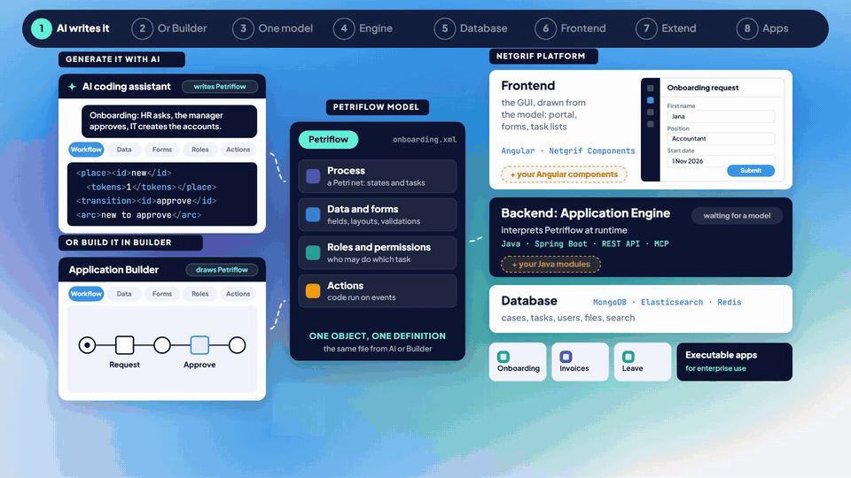

  

<h1 align="center">Turn business processes into complete applications.</h1>

  One model instead of three layers of code. 
  Describe a process to your AI assistant, or <a href="https://builder.netgrif.cloud/modeler">draw it in Builder</a>, and Netgrif runs it as a complete application: 
  user interface, backend and database, with users, roles and permissions built in. 
  Ready for enterprise use, open to your own Java and Angular code.

---

> ### Recommended: [netgrif/ai-code](https://github.com/netgrif/ai-code), Netgrif AI Code
>
> The whole platform in Docker, ready for any AI coding assistant (Claude Code, Codex, Cursor, GitHub Copilot, Gemini CLI or any other).
> Describe a business process, or hand over a document you already have, and the assistant generates a complete
> Netgrif application and runs it on your machine: workflow, data, forms, roles, actions and the menu. All you need
> is Docker.
>
> **[Use this template →](https://github.com/netgrif/ai-code)**

---

A Petriflow model, written by AI or drawn in Builder, runs on the platform's three layers.

## Petriflow: object-centric process software engineering

Most business applications are built around objects that live through a process: a request, an invoice, a contract.
Petriflow describes such an object in **one model**:

- **Workflow:** a Petri net of states and tasks.
- **Data and forms:** the fields, how they are laid out, how they are validated.
- **Roles and permissions:** who may do which task.
- **Actions:** code that runs on events.

Petriflow is a domain-specific language on top of **Java, Angular and a NoSQL database**. You do not write those
three layers by hand: the Netgrif platform interprets the model at runtime.

| Layer        | What Netgrif does with the model                                 | Built with                    |
|--------------|------------------------------------------------------------------|-------------------------------|
| **Frontend** | draws the portal, the forms and the task lists                   | Angular                       |
| **Backend**  | runs the workflow, checks roles, executes the actions, REST API  | Java, Spring Boot             |
| **Database** | stores cases, tasks, users and files, and searches them          | MongoDB, Elasticsearch, Redis |

That is object-centric process software engineering: the model is the application, people can read it, the
platform can check it, and nothing drifts apart between layers. It is also why AI builds Netgrif applications well:
it writes one model, not three layers of code.

Petriflow is featured in *Object-Centric Process Management: The Manifesto* (Information Systems, 2026), written by
more than 60 researchers from RWTH Aachen, TU Munich, TU Wien and Eindhoven University of Technology. Netgrif
applications already run in production in banking, insurance, healthcare and other industries:
[case studies](https://netgrif.com/case-studies/).

## Two ways to build

| | For whom | Start with |
|---|---|---|
| **With AI** (recommended) | Developers and technical analysts. You describe the process, the AI coding assistant generates the application, checks it and runs it. | [**ai-code**](https://github.com/netgrif/ai-code) |
| **Classic development** | Developers who want their own backend and frontend project around the platform, with full control over Java and Angular. | [**nae-backend-application-starter**](https://github.com/netgrif/nae-backend-application-starter) and [**nae-frontend-application-starter**](https://github.com/netgrif/nae-frontend-application-starter) |

Both produce Petriflow models, so you can switch between them. Applications built either way can be extended with
your own Java modules and Angular components.

## Building blocks

The libraries the starters are built on:

| Repository | What it is |
|---|---|
| [**application-engine**](https://github.com/netgrif/application-engine) | The backend: the engine that interprets Petriflow. Java and Spring Boot. |
| [**components**](https://github.com/netgrif/components) | The frontend: Angular libraries `@netgrif/components-core` and `@netgrif/components`. |

### Coming next: Netgrif AI Chat

The people who use your Netgrif applications will be able to work in them by asking: "What is waiting for me?",
"Approve the request from Jana." Always with their own account and rights, and every change waits for their yes.
[Contact us](https://netgrif.com/contact-us/) if you want to try it early.

## Learn and get help

[Petriflow docs](https://petriflow.org/#/) ·
[Platform docs](https://platform.netgrif.cloud/) ·
[Discussions](https://github.com/netgrif/application-engine/discussions) ·
[Issues](https://github.com/netgrif/application-engine/issues) ·
[Contact Netgrif](https://netgrif.com/contact-us/)

**Licence.** Netgrif Community Edition is source-available, not open source, under the NETGRIF Community License.
Its current version is free for development, testing and other non-production use; production needs a commercial
licence. Projects can use different licence versions, so check each repository. To buy a commercial
licence, [contact our sales team](https://netgrif.com/contact-us/). A self-service licence portal is coming:
[join the waiting list](https://netgrif.com/licence-waiting-list/).
